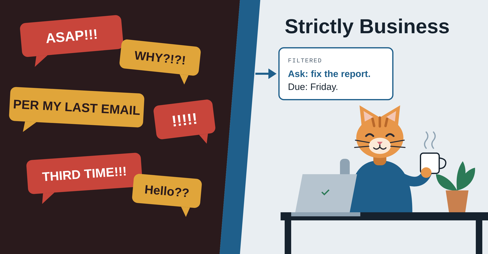

# Strictly Business

No need to have a bad day over an angry message at work. It's just business.

Strictly Business is a small proof of concept. Open a fake work message, see the filtered version, check what's being asked, and get a calm reply to review. The original is always one click away.

## What it shows

- A neutral version of each message
- The ask and the reason for its priority
- Separate importance and emotion ratings, so a loud message isn't automatically an important one
- A calm draft reply for you to review
- A "Read this yourself" flag for sensitive messages

## Status

This is an early demo. All 10 messages are fake, and the results are saved examples from Claude, not a live run. The page doesn't connect to any email or chat account, and it doesn't send anything.

The next step is to test whether tone alone changes how AI ranks a message.
